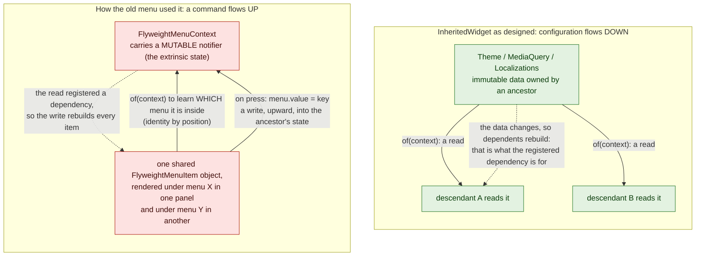
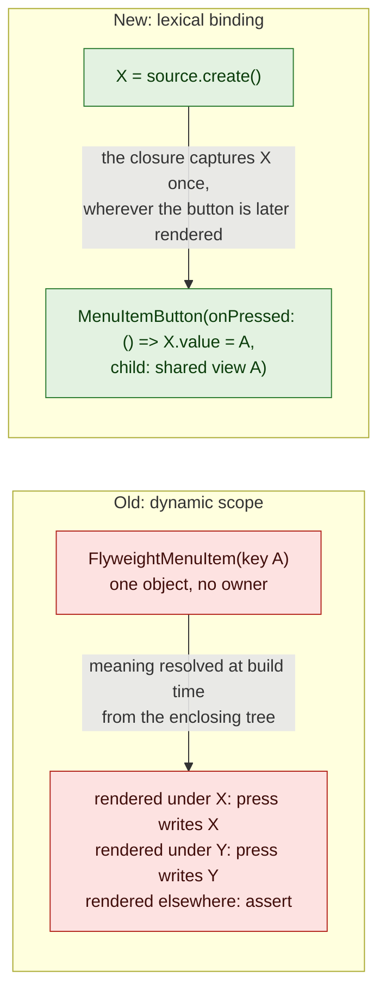
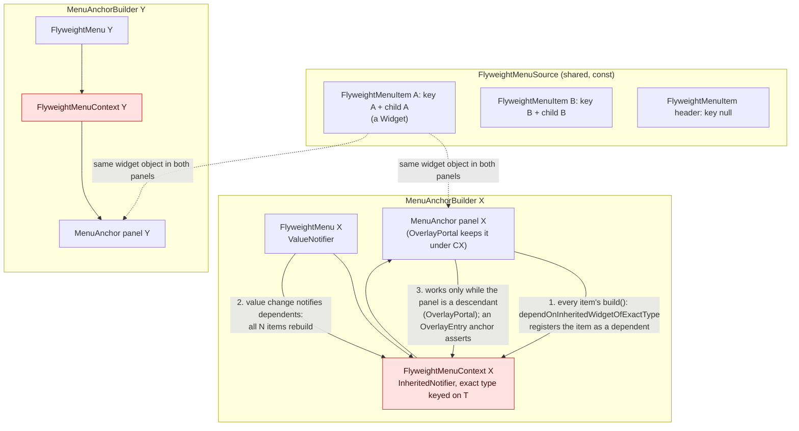
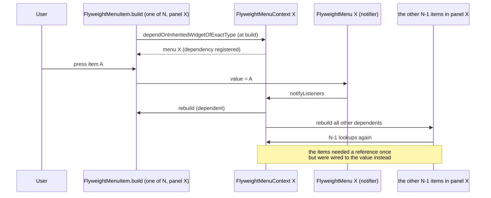
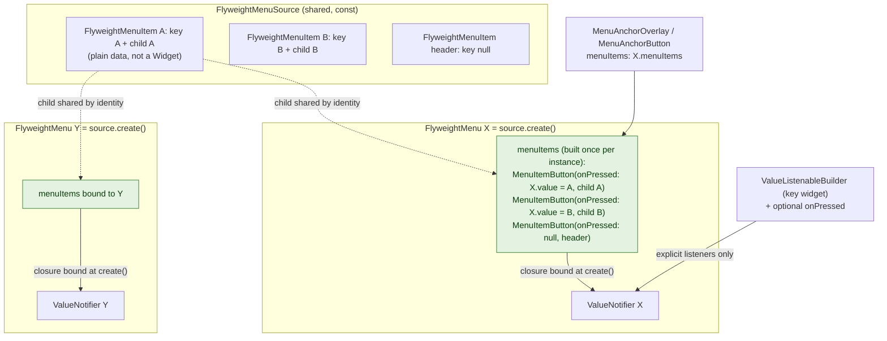
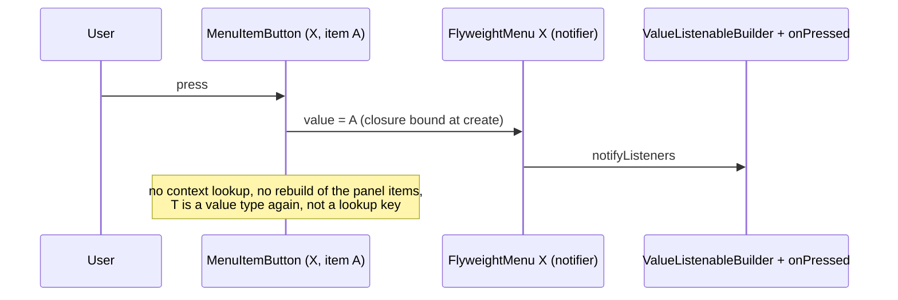

# 0002 The flyweight menu binds its buttons when the instance is created

**Status** — accepted, 2026-11-14 (Part 2 Phase 2, Task 1), on the owner's review question of 2026-11-15.

**Context** — [FlyweightMenuSource] shares one list of menu items across many menus (every `VarIOFieldWithMenu` on the
monitor page has its own selection, the same hundred item views). An item pressed in one menu must update that menu's
notifier only. The first implementation resolved the menu at build time: each item was a widget whose `build` called
`FlyweightMenuContext.of<T>(context)`, an `InheritedNotifier` that every anchor wrapped around its panel. The file header
named the alternative, an init-time shallow copy, and did not take it.

Three things were wrong with the build-time lookup:

1. `dependOnInheritedWidgetOfExactType` registers the item as a dependent of the notifier. An item needs the menu
   reference once; wiring it to the value means every selection rebuilds every item in the open panel.
2. An item's correctness depended on its position in the element tree. It worked only because `MenuAnchor` renders its
   panel through `OverlayPortal`, which keeps the panel a descendant of the anchor; an `OverlayEntry`-based anchor would
   have failed the assert, and an item placed anywhere else did.
3. The exact-type match made `T` a lookup key, so `T` had to be threaded through `VarSelectableBuilder` and
   `VarIOFieldWithMenu` for the lookup to succeed, not for any value it carried.

Why it worked and still sat outside the intent of `InheritedWidget`. The lookup did resolve correctly: an element
carries a map of its inherited ancestors, and `OverlayPortal` gives the panel's elements the anchor's map, so
`dependOnInheritedWidgetOfExactType` found the right context in O(1) without walking. The mechanism, though, exists to
carry immutable configuration down the tree (theme, media query, locale) and to rebuild the descendants that read it
when that configuration changes. The old menu ran it the other way: the inherited widget carried a mutable notifier,
and a shared item object used its render position to decide which notifier to write to on press, so a command flowed
up through a channel built for configuration flowing down, and the read that only needed a reference registered a
rebuild dependency as a side effect. The same widget object meant different things in different places, which is
dynamic scoping; a closure bound at creation is lexical binding, which is what the new design uses.

The structure of the old design, and one press in it:

**Decision** — the init-time shallow copy. The flyweight's intrinsic state, the item key and its view widget, stays
shared and immutable: [FlyweightMenuItem] is plain data `(itemKey, child)`, not a widget. The extrinsic state, which
notifier a press updates, is bound when the instance is created: [FlyweightMenu] composes its source (it no longer
extends it) and builds one thin `MenuItemButton` per item whose `onPressed` closure sets its own `value`. Anchors receive
`menu.menuItems` explicitly; `MenuAnchorBuilder` still creates and disposes the instance. The `InheritedNotifier`
(`FlyweightMenuContext`) and the three classes that only existed around it (`FlyweightMenuOverlay`,
`MenuListenableBuilder`, the throwing `FlyweightMenuTheme`) had no user outside the folder and are deleted.

**Consequences**
- Each instance holds N `MenuItemButton` objects (a few words each); the item views, the expensive part, are still one
  object per item for the whole app. `test/widgets/flyweight_menu_test.dart` pins identity sharing, per-instance
  notification, the disabled header, disposal, and that a selection does not replace the item buttons.
- A selection notifies the explicit listeners only (the key widget's `ValueListenableBuilder`, the optional `onPressed`).
- An item list can be rendered under any anchor; nothing depends on `OverlayPortal`.
- `T` still types the keys and the notifier, but no longer selects an inherited widget. Whether it earns its place on
  [FlyweightMenu] at all is open (the review's question); a plain `Object?` key type would remove the generic.
- `flyweight_menu_widgets.dart` lost its `FlyweightMenuContext` wrappers and `FlyweightMenuOverlay` here; the same file
  then took two unrelated changes in later tasks, so its diff reads larger than this decision: Task 4 removed the
  unused private `MenuAnchorOverlay._` and converted the class to a primary constructor, and Task 11 added keyboard
  access and semantics (`Semantics` + `CallbackShortcuts` around the anchor, the menu button's tooltip).
