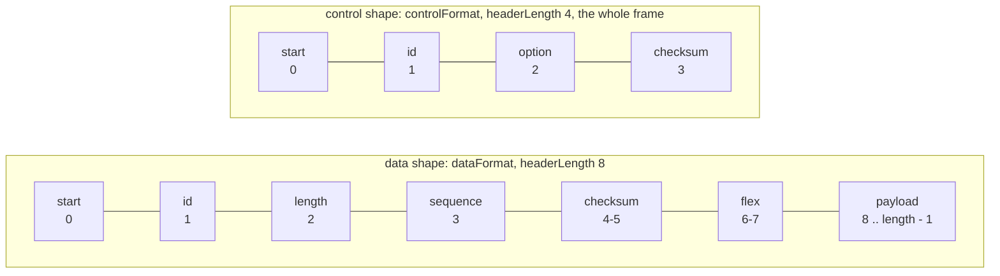
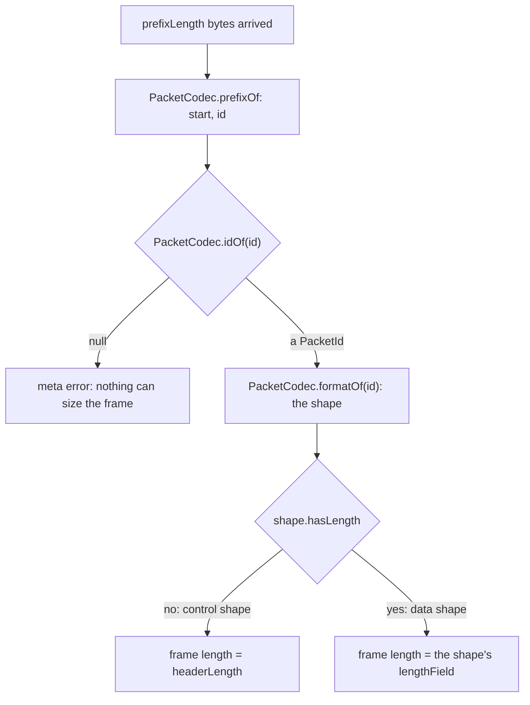
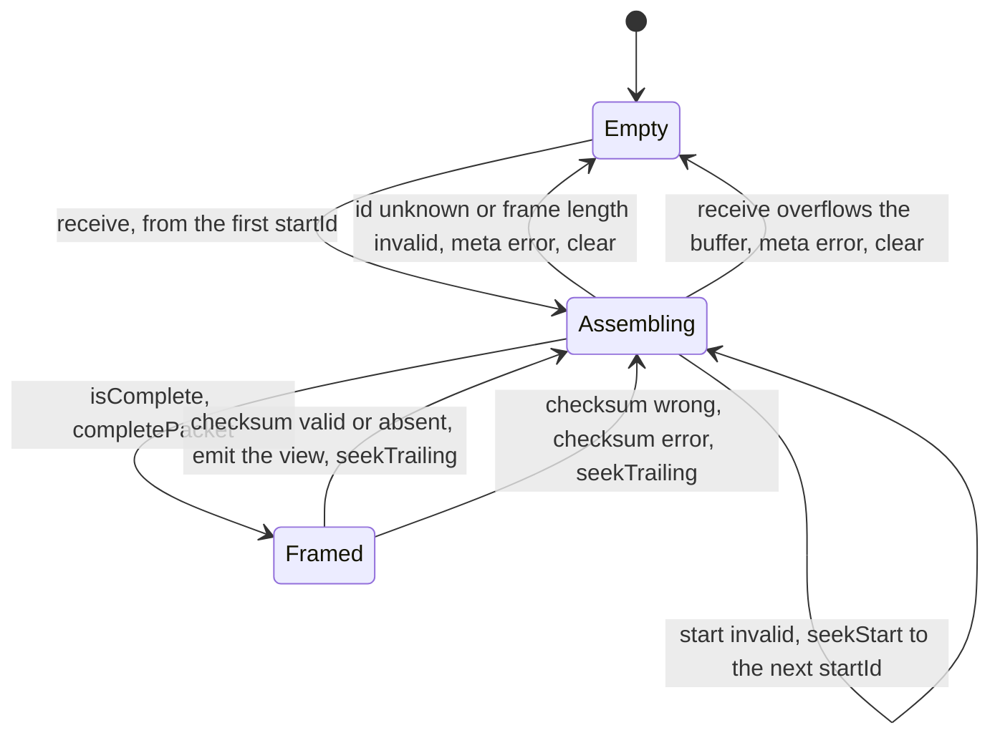

# Packet framework design

Source: `packages/struct_data/lib/src/packet/`, exported by `package:struct_data/packet.dart`.

The dartdoc on each type states its contract. This file holds what a doc comment cannot: the frame and parse
diagrams, the reasons behind the shapes, and what changed from the module before it (`PacketFormat`). What a payload
may depend on when it is read: [packet_payload.md](../lib/src/packet/packet_payload.md).

| Type | Role |
|---|---|
| `PacketCodec` | One protocol's wire format, as `const` data: start byte, longest frame, shapes, id table |
| `PacketFrameFormat` | One frame shape: header length, where its fields lie, its checksum, its header view |
| `PacketId`, `PacketControlId`, `PacketPayloadId<V>`, `PacketRequestId<T, R>` | The id table: control frames, payload ids with their codec, requests with the answer's byte and codec |
| `Payload<V>` | A view over the payload bytes that builds from `V` and parses to `V` |
| `Packet` | Everything a frame can answer, over `(codec, byteData)`; mixed into `PacketView` and `PacketBuffer` |
| `PacketBuffer` | A fixed allocation that is the frame it holds; requests are built in it |
| `HeaderParser`, `PacketTransformer` | The receive buffer, the only code that sees a partial frame, and the byte-stream-to-frame transformer over it |

## Frame

Two shapes of MotProtocol, the protocol `cmdr`'s `MotPacketCodec` declares; `test/packet_test.dart`'s `TestCodec` is
shaped like it. The byte offsets are that protocol's; the roles are the framework's.

- The **prefix** is the first `prefixLength` bytes (MotProtocol: 4). `PacketCodec.prefixOf` reads the start byte and
  the id from it before the shape is known, so every shape of one codec places those two where the prefix reads them.
- The data shape's **length** field carries the total frame length, header plus payload. A shape with no length field
  fixes its own length at `headerLength`, which is how a control frame declares its length: by being one.
- Each shape has its own **checksum**. MotProtocol's data shape sums the bytes either side of a 16-bit field; its
  control shape XORs the first three bytes into byte 3. The default `PacketFrameFormat.checksumOf` is the byte sum;
  a shape whose integrity is not a sum overrides the whole method, because a CRC does not split across the field
  (`crc(a) + crc(b) != crc(a + b)`).
- `lengthMax` (MotProtocol: 40) bounds every frame and sizes every buffer; `payloadLengthMax` is that less the data
  header.

How the parser chooses a shape once the prefix has arrived:

## Parse states

`PacketTransformer.add` hands each read to `HeaderParser.receive`, then loops while the buffer holds bytes. Each arm
of its `switch` is a question about how much has arrived, and the getters are re-read per arm, so the loop always
sees the current buffer.

- `seekStart` and `seekTrailing` leave the buffer empty when no bytes remain, which ends the loop; the next read is
  then searched for the start byte again.
- The loop terminates: a meta error empties the buffer, and a checksum error is reachable only after
  `completePacket` has split off a whole frame, so `seekTrailing` always shortens it.
- `completePacket` runs before the checksum is read: the checksum covers exactly the frame, so the view must end
  where the frame does, not where the last read did.
- The frame emitted is a view of the parser's buffer, not a copy. A listener finishes with it before yielding, or
  copies it; that is what lets a frame reach an application without an allocation per packet.

The validity getters on `HeaderParser` (`isStartFieldValid`, `isIdFieldValid`, `isFrameLengthValid`,
`isChecksumFieldValid`) read in three states, because a partial frame is a buffer filling up:

| Value | Meaning |
|---|---|
| `null` | the bytes have not arrived |
| `false` | arrived and wrong |
| `true` | arrived and right |

The field getters read through the shapes' `ByteField` descriptors, not a struct cast, because `Struct.create` throws below
its own length and below full length is where the parser operates. That is also why a codec whose shape reads its
header as an `ffi.Struct` overrides `prefixOf` with a struct sized to `prefixLength` (MotProtocol's
`MotPacketHeaderPrefix`).

## Build order

`Packet.buildRequest(id, values)` is the whole frame:

1. `buildPayload` casts the id's payload codec over `storage` from the end of the id's header, and the payload writes
   `values` and returns a `PayloadMeta` with its length.
2. `buildHeader` clears the header bytes, so reserved bytes never carry the previous frame's, then writes start, id
   and length (`PacketFrameFormat.frameLengthOf`), and the checksum last, because it covers the length.
3. `PacketBuffer.buildHeader` then brings the buffer's end in to the frame just written. If the payload throws,
   `PacketBuffer.buildRequest` clears the buffer, so a valid-looking header never sits on a half-written body.

A control frame is steps 2 and 3 alone (`PacketBuffer.buildControl`).

## Why the shapes are what they are

### A protocol is data: `PacketCodec`

`PacketCodec` succeeds `PacketFormat`. Three things changed.

- **No factory members.** `PacketFormat<T extends Packet>` required `cast`, `caster`, `headerOf` and `syncHeaderOf`
  so that generic code could manufacture a protocol's own `Packet` subclass. `Packet` is now a mixin over
  `(codec, byteData)`, so a protocol contributes data and nothing else: no subclass, no casters.
  `MotPacketInterface`, `MotPacket`, `MotPacketHeader` and `MotPacketHeaderControl` collapse into one `const`
  subclass of `PacketCodec` and two `PacketFrameFormat`s.
- **One description of each layout.** `PacketFormat` described the header twice, once as `ByteField` offsets and once
  as an `ffi.Struct`, and nothing kept the two in step. The descriptors are the survivor: they are the only half that
  can read a partial buffer, which is the parser's whole job. An `ffi.Struct` cast throws below full length.
- **Endian is honoured.** Header fields were read through `ByteField.getInOrNull`, which hardcodes little-endian and
  never consulted `PacketFormat.endian`. Every descriptor access now passes the shape's `PacketFrameFormat.endian`.

### A shape is data too: `PacketFrameFormat`

A protocol has more than one shape, and they disagree about more than length: MotProtocol's data header is 8 bytes
with a 16-bit sum at offset 4, its control frame 4 bytes with a 1-byte XOR at offset 3. A single set of descriptors
on the codec could describe only one of them, which is why `PacketFormat` could neither write nor check a control
frame's check byte: the data checksum field lies past a control frame entirely.

`PacketFrameFormat` is a configuration interface with shared derivations. As a `mixin class` a shape is a named
`const` class that states the few members it differs on and inherits the rest: two or three per protocol, each one
readable on its own, rather than one class configured by a list of named arguments. `lengthField` and
`checksumField` default to absent, so a control shape names neither.

`headerOf` and `checksumOf` are the two members a shape overrides with behaviour rather than data. Both are plain
virtual methods. `PacketFormat` carried `headerOf` as a nullable function field, which said the same thing with a
`?.call(...) ?? default` at the use site.

### One prefix, read by the codec

The prefix is the codec's, not a shape's, because it is what chooses a shape. The previous module also asserted
`PacketCodec.hasConsistentIdPrefix` in the parser's constructor: every shape had to place its delimiter and id
identically. With one prefix view for the whole protocol the check went. The constraint did not: a shape still
writes its start and id through its own header, and the parser still reads them through the prefix, so the two must
agree. `PacketFrameFormat.startField` and `PacketCodec.prefixOf` state it.

### `Packet` is a mixin, so a buffer is a packet

The two things that hold frame bytes both are packets rather than containing one: `PacketView` for a detached frame,
and `PacketBuffer` for a frame being filled. The buffer previously exposed a `buffered` view for writing and a
`packet` view for reading, and every caller had to know which it wanted. With the mixin, `buffer.payloadAsList()` and
`buffer.parseResponse(...)` say what they mean.

### `PacketBuffer`: the allocation is the frame

There is one object rather than a buffer plus two views of it. The previous version exposed `buffered` (the whole
allocation, to write through) and `packet` (what was valid, to read), and every caller had to pick. Now
`lengthInBytes` is the end, `byteData` is bounded by it, and `storage` is the allocation a request is built in.

It replaces `PacketBuffer extends ByteStructBuffer<T extends Packet>`. `ByteStructBuffer` existed to carry a
`TypedDataCaster<T>` so a generic buffer could produce a protocol's own `Packet` subclass. With no subclass to
produce there is no caster to carry, and the intermediate class had no other member and no other user.

### The payload offset comes from the frame's own shape

A shape with a shorter header puts its payload where that header ends, and `Packet.payloadOffset` reads that from
the frame's own `format`. It could not while building went through a packet: a payload is written before the id is,
so an offset read from the buffer's own contents was circular. Building now goes through `PacketBuffer` and the
whole allocation, taking the offset from the id being built, which leaves the read side free to ask the frame.

### Smaller API history

- `Packet.payloadAsList<R>()`: every call site of `payloadAt` in the Mot payload table spelled it out as
  `payloadAt<Uint16List>(0, parsePayloadLength ~/ 2)`, the divisor restating a width the type argument already
  carries.
- `Packet.parsePayload(id)` takes the id rather than a caster: the id carries its own codec, so there is one way in
  instead of a caster-taking method plus an id-taking wrapper around it.

### `PacketControlId` is named for the frame shape

Membership is by frame shape, which is what the framing acts on, and the name fits because a liveness probe and a
termination are control traffic just as an acknowledgment is. It is not `PacketSyncId`: only two of the four
synchronise anything, and `sync` already means synchronous execution in Dart and the start
delimiter in framing.

### `PacketRequestId`: two non-nullable members, not three nullable ones

The original model had `responseId`, `requestCaster` and `responseCaster` all nullable, and put the nullability on
the wrong axis. `responseId` was null for "the answer comes back under the same byte", which is the common case,
while the response codec differs even then, so it was carried separately and unwrapped with `!` at every call site.

Now both casters are required (`caster` reads the request, `responseCaster` the answer), and `responseId` defaults to
the request's own byte in the constructor. Same byte, different codec, the common case, is then the short form, and
a different byte is one extra argument. Nothing is nullable, so nothing is unwrapped.

`responseId` is an `int` rather than a `PacketPayloadId` deliberately. Modelling the answer as its own id also
removes the nullability, but it forces a second id table: `PacketId` implements `Enum`, so every id must be an enum
value, and an exchange then spans two rows in two enums. Nothing downstream needs the answer to be an id: routing
wants the byte, and decoding wants the caster. Carrying both directly keeps one row per exchange.

One-way is expressed by not being a `PacketRequestId`. The type, rather than a null, carries whether an answer is
expected.

### Build is not the mirror of parse

`Payload.build` returns a `PayloadMeta` instead of writing into a header. The two directions do not carry the same
information, and pretending they do costs correctness.

On parse a header exists, full of values a body may be governed by. On build there is no header yet: its fields come
from two places, the id table and the payload, so a payload does not read a header, it contributes to one. Handing it
a live header to write into means the header must be stamped before the payload runs, which is what makes a
half-built frame possible, and it hands a payload write access to `idField`, `startField` and `checksumField`, none
of which are its to set. Returning what it decided lets the framing write the header once, afterwards, from a
payload that cannot corrupt it.

For the same reason `PayloadMeta` is not a `PacketHeaderPrefix`. A shared interface would have to be the intersection
of what a payload knows and what a read header knows, which is the one number `PayloadMeta.length` wearing a name
that claims more.

The device agrees once `p_TxMeta` is read for what it is: not a view of the frame but a normalized staging struct
that `BUILD_TX_FRAME` serializes afterwards. A handler there also reports metadata for the framing to place, by
writing a struct rather than returning one. The symmetry on that side is between two staging structs, not between a
struct and a live frame.
